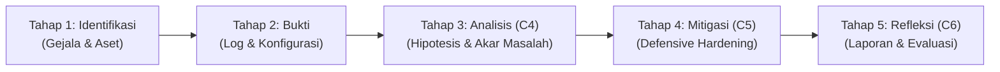
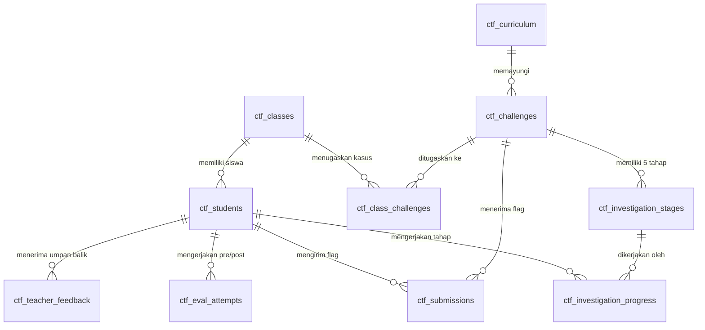

# CyberLab CTF — National Innovation Edition
### Master Blueprint & Spesifikasi Desain: "Buku Catatan Lapangan Peretas"
**Platform Edukasi Keamanan Siber Berbasis Problem-Based Learning, Digital Forensics, & HOTS (C4–C6) untuk SMK TJKT**

> **Identitas Visual:** *Hangat seperti kertas, tajam seperti terminal, jujur seperti catatan tangan.*  
> **Identitas Pedagogis:** Mengubah paradigma CTF dari sekadar *"menebak flag"* menjadi **Investigasi Forensik Digital 5 Tahap** berbasis bukti nyata (*Evidence-Based Learning*), terukur dengan Kriteria Ketercapaian Tujuan Pembelajaran (KKTP) Kurikulum Merdeka.

---

## DAFTAR ISI BLUEPRINT
1. **Laporan Audit Proyek & Analisis Kesenjangan (Gap Analysis)**
2. **Matriks Perbandingan: Fitur Eksisting vs Fitur Inovasi Nasional**
3. **Filosofi Visual & Desain "Buku Catatan Lapangan Peretas" (Tetap Dipertahankan 100%)**
4. **Modul 1: HOTS Investigation Engine (5 Tahap Investigasi Forensik)**
5. **Modul 2: Smart Assessment Engine & Rubrik Analitik KKTP**
6. **Modul 3: Teacher Learning Analytics Dashboard (Buku Besar Diagnostik)**
7. **Modul 4: Integrasi Kurikulum Merdeka TJKT & LKPD Digital**
8. **Modul 5: Sistem Evaluasi Pretest, Posttest, & Komputasi N-Gain Ilmiah**
9. **Modul 6: Portofolio Investigasi Digital Siswa (Evidence Ledger)**
10. **Modul 7: Arsitektur Database Supabase PostgreSQL, ERD, & RLS Policies**
11. **Modul 8: Arsitektur Backend Node.js & Keamanan Laboratorium Terisolasi**
12. **Modul 9: Portabilitas & Kompatibilitas Deployment Vercel**
13. **Modul 10: Standar Kesiapan Lomba Inovasi Pembelajaran Nasional & Uji Ahli**
14. **Roadmap Implementasi Bertahap & Kriteria Penerimaan (Acceptance Criteria)**

---

## 1. Laporan Audit Proyek & Analisis Kesenjangan (Gap Analysis)

### 1.1. Status Infrastruktur Saat Ini
* **Backend:** Native Node.js (modul bawaan: `http`, `https`, `crypto`, `fs`, `path`). Tidak menggunakan Express, sehingga performa sangat tinggi, zero-dependency, dan kompatibel langsung dengan Vercel Serverless Function (`api/index.js` mengimpor `server.js`).
* **Frontend:** Vanilla JavaScript modern (`public/app.js`, `public/index.html`, `public/style.css`). Mengusung antarmuka *Dossier File / Binder Tabs* analog (Sampul 01, Tujuan 02, Berkas Materi 03, Meja Kasus 04, Konsol Terminal 05, Roster Skor 06, Ruang Guru 07).
* **Database:** Dual-engine sinkron. Mengutamakan PostgreSQL cloud Supabase (`ctf_challenges`, `ctf_students`, `ctf_submissions`, `ctf_curriculum`) via RESTful PostgREST, dengan fallback mirror lokal `data/progress.json`.
* **Koleksi Kasus:** 60 kasus terstruktur dari Low (Dasar), Medium (Menengah), hingga High (Tinggi) mencakup 4 pilar TJKT: Linux Server (1–20), Jaringan & Firewall (21–40), Cyber & Web (41–55), dan Hardware/IoT (56–60).

### 1.2. Analisis Kesenjangan Menuju Standar Inovasi Nasional
| Aspek | Kondisi Saat Ini (Eksisting) | Target Inovasi Nasional (National Edition) | Kesenjangan (Gap) |
|---|---|---|---|
| **Pola Belajar** | Siswa membaca materi, mencoba terminal, memasukkan flag string (single input). | Alur investigasi 5 tahap (Identifikasi → Bukti → Analisis → Mitigasi → Refleksi). | Kasus belum mewajibkan perumusan hipotesis & bukti log sistem. |
| **Dimensi Kognitif** | C1–C3 (Mengingat perintah, Menjalankan sintaks terminal). | C4 (Analisis Anomali), C5 (Evaluasi Konfigurasi), C6 (Mendesain Aturan Mitigasi). | Belum ada rubrik HOTS formal dan LKPD terintegrasi. |
| **Penilaian Guru** | Skor biner (Benar = Dapat XP, Salah = 0) + First Blood bonus. | Smart Assessment: Rubrik analitik berbobot, validasi bukti otomatis, dan konversi KKTP. | Penilaian belum membedakan proses berpikir siswa dengan tebakan flag. |
| **Bukti Belajar** | Flag tersimpan di log submission (`ctf_submissions`). | Digital Evidence Ledger: Riwayat perintah terminal, file artefak, hipotesis tertulis, dan catatan refleksi. | Siswa belum memiliki dokumen portofolio investigasi yang dapat diunduh. |
| **Evaluasi Dampak** | Hanya skor leaderboard akumulatif. | Pretest & Posttest terstandar dengan komputasi *Normalized Gain* ($N\text{-gain}$) otomatis. | Belum ada instrumen riset tindakan kelas untuk mengukur efektivitas media. |
| **Analitik Guru** | Rekap nilai angka, rata-rata, dan ekspor CSV sederhana. | Dashboard Diagnostik: Distribusi KKTP, radar capaian C4–C6, rekomendasi remedial/pengayaan, grafik kemajuan. | Guru belum mendapatkan rekomendasi intervensi pedagogis berbasis data. |

---

## 2. Matriks Perbandingan: Fitur Eksisting vs Fitur Baru

```text
+--------------------------------------------------------------------------------------------------+
| ARSITEKTUR FITUR CYBERLAB CTF                                                                     |
+--------------------------------------------------------------------------------------------------+
| FITUR EKSISTING (DIPERTAHANKAN 100%)              | FITUR INOVASI NASIONAL (DITAMBAHKAN)         |
|---------------------------------------------------+----------------------------------------------|
| [✓] Visual Buku Catatan Lapangan Peretas          | [+] HOTS Investigation Stepper (5 Tahap)     |
| [✓] Palet Kertas, Tinta, Pensil, Merah Bata, CRT  | [+] Form Perumusan Masalah & Hipotesis       |
| [✓] Simulator Terminal Linux Interaktif           | [+] Digital Evidence Vault (Log & Artifacts) |
| [✓] Microcassette Analog Audio Narration          | [+] Defense Validator (Pengujian Mitigasi)   |
| [✓] Single Sign-On / Registrasi Mandiri Siswa     | [+] Rubrik Analitik KKTP Terkonfigurasi      |
| [✓] Panel Guru & Reset Sandi Darurat              | [+] Pretest & Posttest Evaluator (N-Gain)    |
| [✓] 60 Skenario Kasus Lengkap Kurikulum TJKT      | [+] Portofolio Investigasi PDF Cetak         |
| [✓] Sinkronisasi Supabase Cloud Real-time         | [+] Radar Kompetensi C4, C5, C6              |
| [✓] Dynamic Scoring & First Blood Bonus           | [+] Instrumen Validasi Ahli Pembelajaran     |
| [✓] Mode Ujian dengan Flag Dinamis Siswa          | [+] Isolasi Sandbox VirtualBox Runner (Spec) |
+--------------------------------------------------------------------------------------------------+
```

---

## 3. Filosofi Desain Visual "Buku Catatan Lapangan Peretas"
*(Prinsip ini dijaga ketat agar tidak berubah menjadi template SaaS modern yang dingin)*

### 3.1. Karakter & Esensi Visual
* **Kertas Bertekstur**: Latar halaman menggunakan warna `--kertas` (`#F2EBDD`) dengan tekstur bintik halus kertas daur ulang / memo kantor forensik.
* **Tinta & Pensil**: Tulisan utama berwarna hitam arang `--tinta` (`#1E1B16`), catatan sekunder `--pensil` (`#6B6355`).
* **Stempel Fisik Timbul**: Status kasus menggunakan stempel merah bata `--merah-bata` (`#B8402A`) dengan sudut kemiringan acak -4° s/d 3° bertuliskan `"RAHASIA"`, `"TERPECAHKAN"`, atau `"MENUNGGU VERIFIKASI"`.
* **Layar Telemetri Tabung (CRT)**: Terminal Linux vintage menggunakan latar `--layar` (`#14170F`) dan pendaran hijau fosfor `--fosfor` (`#7FD36B`).
* **Catatan Pinggir Mentor (Marginalia)**: Menggunakan font tulisan tangan natural (*Caveat*) dengan coretan panah pensil mengarah langsung ke konsep teknis yang dianalisis.
* **Tanpa Gradien Neon & Tanpa Glassmorphism**: Elemen visual tegas dengan bayangan offset solid `3px 3px 0 var(--tinta)`.

---

## 4. MODUL 1 — HOTS INVESTIGATION ENGINE (5 TAHAP INVESTIGASI)

Setiap tantangan dari 60 kasus CTF ditransformasikan dari format satu pertanyaan biasa menjadi alur penyelidikan insiden 5 tahap terstruktur:



### Rincian Alur per Tahap:

#### Tahap 1: Identifikasi Insiden & Orientasi Lapangan
* **Aktivitas Siswa**: Membaca ringkasan laporan telemetri, mengidentifikasi aset yang diserang (IP, port, layanan), serta menentukan gejala anomali (DoS, privilege escalation, unauthorized access, sniffing).
* **Indikator**: Kemampuan merumuskan fokus masalah teknis dan batasan sistem.
* **Input Siswa**: Isian formulir formulasi masalah & pemilihan parameter aset yang terindikasi disusupi.

#### Tahap 2: Pengumpulan & Verifikasi Bukti Forensik
* **Aktivitas Siswa**: Menjalankan simulator terminal Linux untuk menelusuri berkas konfigurasi (`/etc/ssh/sshd_config`, `/etc/sudoers`), berkas log (`/var/log/auth.log`, `/var/log/syslog`), atau memeriksa permission binary SUID.
* **Indikator**: Keterampilan mengoperasikan perkakas diagnostik sistem dan mengekstrak artefak digital yang valid.
* **Input Siswa**: Bukti potongan log/output terminal yang ditandai sebagai artefak investigasi.

#### Tahap 3: Analisis Anomali & Rekonstruksi Serangan (HOTS C4)
* **Aktivitas Siswa**: Menghubungkan temuan bukti dengan konsep protokol. Siswa menyusun hipotesis: *"Mengapa celah ini terbuka?"*, *"Bagaimana penyerang berpindah dari user biasa menjadi root?"*.
* **Indikator**: Keterampilan menganalisis relasi sebab-akibat kegagalan konfigurasi keamanan (*Root Cause Analysis*).
* **Input Siswa**: Penjelasan teknis akar masalah + verifikasi kunci investigasi (*evidence flag*).

#### Tahap 4: Mitigasi & Penguatan Pertahanan Sistem (HOTS C5)
* **Aktivitas Siswa**: Memilih langkah perbaikan (remediasi defensif). Siswa menentukan baris konfigurasi yang benar, hak akses file (`chmod/chown`), atau aturan firewall (`iptables/ufw`).
* **Indikator**: Kemampuan mengevaluasi kelayakan solusi pertahanan dan mencegah eksploitasi berulang.
* **Input Siswa**: Sintaks perintah mitigasi atau pemilihan konfigurasi perbaikan yang divalidasi otomatis oleh sistem (*Defensive Validator*).

#### Tahap 5: Refleksi Pedagogis & Pembuatan Berita Acara (HOTS C6)
* **Aktivitas Siswa**: Menyusun ringkasan eksekutif (*Incident Response Report*) yang berisi kesimpulan, evaluasi keputusan, serta rekomendasi pencegahan untuk administrator sistem di masa depan.
* **Indikator**: Kemampuan mengonseptualisasikan pelajaran yang dipetik (*lessons learned*) ke dalam standar operasional prosedur (SOP).
* **Input Siswa**: Esai refleksi terstruktur siswa.

---

## 5. MODUL 2 — SMART ASSESSMENT ENGINE & RUBRIK KKTP

Sistem penilaian tidak lagi hanya melihat apakah string flag cocok atau tidak. Skor akhir kasus dikomputasi dari rubrik analitik multi-dimensi:

### 5.1. Komposisi Bobot Standar (Dapat Disesuaikan Guru)
1. **Identifikasi Masalah (15%)**: Ketepatan mengenali indikator kompromi (IoC).
2. **Pengumpulan Bukti (20%)**: Keabsahan artefak log dan perintah forensik yang digunakan.
3. **Analisis Akar Masalah / C4 (25%)**: Kedalaman logika dalam merekonstruksi alur penyerangan.
4. **Validasi Mitigasi / C5 (25%)**: Efektivitas solusi perbaikan konfigurasi sistem.
5. **Refleksi & Pelaporan / C6 (15%)**: Kejelasan sintesis berita acara dan simpulan SOP.

### 5.2. Kategori Kriteria Ketercapaian Tujuan Pembelajaran (KKTP)
Berdasarkan panduan Kurikulum Merdeka SMK, perolehan nilai siswa dikelompokkan ke dalam 4 interval:
* **0 – 69 (Perlu Bimbingan / Remedial Khusus)**: Belum mencapai kriteria minimum. Membutuhkan modul remidiasi dan panduan terpandu guru.
* **70 – 79 (Cukup / Remedial Terfokus)**: Memahami sintaks dasar terminal namun lemah pada perumusan hipotesis akar masalah.
* **80 – 89 (Baik / Tuntas)**: Berhasil menganalisis anomali, membuktikan eksploitasi, dan mengaplikasikan konfigurasi mitigasi.
* **90 – 100 (Sangat Baik / Pengayaan)**: Menguasai seluruh tahapan investigasi, mitigasi presisi, dan menuliskan rekomendasi SOP mitigasi tingkat lanjut.

---

## 6. MODUL 3 — DASHBOARD ANALITIK GURU (BUKU BESAR DIAGNOSTIK)

Dirancang khusus dengan estetika **Buku Besar Penilaian Guru**, menampilkan telemetri belajar nyata:
* **Kartu Metrik Makro**: Total Siswa Aktif, Rata-rata Skor Diagnostik Kelas, Ketuntasan KKTP (%), dan Rasio Remedial.
* **Diagram Radar Capaian HOTS**: Visualisasi pencapaian rata-rata kelas pada dimensi **C4 (Analisis)**, **C5 (Evaluasi)**, dan **C6 (Kreasi/Mitigasi)**.
* **Buku Ledger Ketuntasan Siswa**: Tabel nilai detail menampilkan: Nama, Kelas, NISN, Progres Tahap 1–5, Poin XP, Predikat KKTP, serta tombol *"Buka Portofolio Siswa"*.
* **Pusat Rekomendasi Remedial & Pengayaan**: Daftar otomatis siswa yang memerlukan intervensi pada topik spesifik (misal: *"3 siswa mengalami kendala pada analisis hak akses Linux SUID"*).
* **Alat Ekspor Resmi**:
  - Rekap Nilai Format Rapor Merdeka (CSV / Excel).
  - Lembar Bukti Hasil Pembelajaran untuk Portofolio Lomba Guru (PDF Siap Cetak).

---

## 7. MODUL 4 — INTEGRASI KURIKULUM MERDEKA TJKT & LKPD DIGITAL

Menghubungkan struktur kurikulum dari hulu ke hilir:
$$\text{Fase F (SMK TJKT)} \longrightarrow \text{Elemen Kompetensi} \longrightarrow \text{Tujuan Pembelajaran (TP)} \longrightarrow \text{Indikator HOTS} \longrightarrow \text{Kasus CTF} \longrightarrow \text{LKPD Digital}$$

### 4 Pilar Kompetensi & Distribusi 60 Kasus:
1. **TP-01: Linux Dasar & Administrasi Server** (Kasus #001 s/d #020)
   - *Fokus*: File system hierarchy, permission rwx, SUID/SGID, sudoers policy, cron jobs security, log forensic (`auth.log`), service isolation (SSH, Apache, Nginx).
2. **TP-02: Jaringan Komputer, Protokol & Firewall** (Kasus #021 s/d #040)
   - *Fokus*: Packet analysis, ARP spoofing detection, DNS poisoning, VLAN hopping, port scanning analysis, iptables stateful filtering, port knocking, NAT manipulation.
3. **TP-03: Keamanan Siber, Web & Kriptografi Forensik** (Kasus #041 s/d #055)
   - *Fokus*: Insecure direct object reference (IDOR), SQL injection parameter bypass, broken cookie authentication, reverse shell detection, Base64/Hex/XOR decryption, hashing integrity.
4. **TP-04: Keamanan Perangkat Keras, IoT & Serial** (Kasus #056 s/d #060)
   - *Fokus*: UART serial baudrate debugging, firmware plain text leak extraction, IoT default credentials exploitation, embedded bus traffic sniffing.

### Lembar Kerja Peserta Didik (LKPD) Digital:
Siswa dapat mengerjakan LKPD langsung di platform secara terintegrasi dengan simulator, tanpa harus membuka dokumen kertas terpisah. Guru dapat mengunduh kompilasi LKPD seluruh kelas sebagai artefak bukti pembelajaran.

---

## 8. MODUL 5 — SISTEM EVALUASI PRETEST, POSTTEST, & N-GAIN

Untuk kebutuhan penelitian tindakan kelas (PTK), evaluasi efektivitas media pembelajaran, atau pembuktian lomba karya inovasi:
* **Bank Soal Evaluasi**: Soal pilihan ganda konseptual dan studi kasus singkat yang setara pada Pretest dan Posttest.
* **Perhitungan Normalized Gain ($N\text{-gain}$)** otomatis:
$$g = \frac{S_{\text{post}} - S_{\text{pre}}}{S_{\text{max}} - S_{\text{pre}}}$$
* **Interpretasi $N\text{-gain}$ Ilmiah (Hake, 1999)**:
  - $g \ge 0.70$ : Efektivitas Tinggi
  - $0.30 \le g < 0.70$ : Efektivitas Sedang
  - $g < 0.30$ : Efektivitas Rendah
* **Data Bersih & Etis**: Tidak ada rekayasa data. Hasil dihitung murni dari respons nyata siswa, siap disajikan ke hadapan dewan juri lomba inovasi.

---

## 9. MODUL 6 — PORTOFOLIO INVESTIGASI DIGITAL (EVIDENCE LEDGER)

Setiap siswa memiliki halaman buku catatan pribadi (*Personal Investigation Dossier*) yang merangkum bukti kompetensi nyata:
1. **Kronologi Kasus**: Tanggal dan jam kasus diselesaikan.
2. **Rekaman Terminal Telemetri**: Perintah-perintah Linux yang berhasil dieksekusi.
3. **Catatan Hipotesis & Esai Refleksi**: Narasi penalaran siswa saat memecahkan insiden.
4. **Catatan Validasi & Umpan Balik Guru**: Catatan pembinaan langsung dari instruktur.
5. **Cetak Portofolio Mandiri**: Tombol cetak ramah dokumen (clean print layout) untuk portofolio magang industri siswa TJKT.

---

## 10. MODUL 7 — ARSITEKTUR DATABASE SUPABASE POSTGRESQL

Struktur skema database baru dirancang **kompatibel mundur (backward compatible)** dengan tabel yang sudah berjalan (`ctf_challenges`, `ctf_students`, `ctf_submissions`, `ctf_curriculum`).

### 10.1. Diagram Relasi Entitas (ERD)



### 10.2. Daftar Tabel Baru & Perannya
1. `ctf_classes`: Pengelolaan kelas (e.g. XII TJKT 1, XI TJKT 2) dengan kode kelas unik.
2. `ctf_investigation_stages`: Menyimpan detail 5 tahap investigasi untuk masing-masing dari 60 kasus CTF.
3. `ctf_investigation_progress`: Menyimpan jawaban tahap, bukti log, hipotesis siswa, kode mitigasi, dan refleksi per kasus.
4. `ctf_rubrics`: Master kriteria penilaian HOTS (C4, C5, C6) dan bobot persentase.
5. `ctf_eval_questions`: Bank soal pretest dan posttest diagnostik kompetensi siber.
6. `ctf_eval_attempts`: Nilai pretest, posttest, dan perhitungan skor $N\text{-gain}$ per siswa.
7. `ctf_teacher_feedback`: Catatan pembinaan, penilaian rubrik uraian, dan umpan balik personal guru.

### 10.3. Keamanan & Kebijakan RLS (Row Level Security)
* Siswa hanya dapat membaca kasus aktif dan hanya dapat membuat/mengubah progres miliknya sendiri.
* Guru/Administrator memiliki akses penuh membaca seluruh progres kelas dan memberikan penilaian serta umpan balik.
* Backend serverless menggunakan *Service Role* tepercaya untuk komputasi analitik sensitif.

---

## 11. MODUL 8 — ARSITEKTUR BACKEND NODE.JS & KEAMANAN LABORATORIUM

### 11.1. Lapisan Simulasi Aman (Zero-Risk Browser Sandbox)
* Simulator terminal berbasis parser deterministik di client-side: perintah-perintah Linux standar (`pwd`, `ls -la`, `cat`, `curl -i`, `sudo -l`, `find`, `decode`, `clear`) diproses secara aman tanpa mengeksekusi shell langsung pada mesin host Vercel.
* **Keuntungan**: Keamanan 100% dari celah Remote Code Execution (RCE), biaya hosting Rp0 di Vercel, dan kecepatan instan tanpa latensi server.

### 11.2. Cetak Biru Laboratorium Nyata (Ubuntu Server VirtualBox Runner)
Untuk sekolah yang ingin menghubungkan terminal siswa ke Ubuntu Server fisik di lab sekolah:
* **Arsitektur Runner Terisolasi**:
  Siswa → Browser CyberLab CTF → Backend Node.js (Proxy Endpoint Aman) → Runner Agen Terisolasi di Lab Sekolah (VM Ubuntu VirtualBox Host-Only Network).
* **Fitur Pengaman**: Snapshot VM di-revert otomatis setiap 30 menit, pembatasan CPU 1 core, memori 512 MB, serta isolasi VLAN tanpa akses internet keluar.

---

## 12. MODUL 9 — PORTABILITAS & KOMPATIBILITAS DEPLOYMENT VERCEL

* Seluruh kode backend tetap berjalan di dalam single-entry serverless handler (`server.js` dipanggil oleh `api/index.js`).
* Penyimpanan file konfigurasi mirror lokal otomatis mendeteksi lingkungan Vercel (`/tmp` storage) tanpa merusak integritas server.
* Waktu respons API dioptimalkan di bawah 200ms melalui database indexing pada kolom `id`, `category`, `difficulty`, dan `student_name`.

---

## 13. MODUL 10 — STANDAR KESIAPAN LOMBA INOVASI PEMBELAJARAN NASIONAL

Platform dilengkapi berkas pelengkap inovasi:
1. **Instrumen Uji Validitas Ahli Materi & Ahli Media Pembelajaran**: Lembar kuisioner skala Likert (1–5) terintegrasi untuk mengukur kevalidan media pembelajaran.
2. **Lembar Persepsi & Respons Siswa**: Survei *Usability & Learning Engagement* bawaan platform.
3. **Fitur Ekspor Bukti Portofolio Inovasi**: Halaman kompilasi laporan yang menyajikan grafik pertumbuhan hasil belajar, dokumentasi interaksi terminal, dan hasil analisis pedagogis siap cetak.

---

## 14. ROADMAP IMPLEMENTASI BERTAHAP & KRITERIA PENERIMAAN

### Rencana Aksi Bertahap:
* **Fase 1 (Selesai)**: Sinkronisasi 60 kasus lengkap, integrasi database Supabase real-time, eliminasi bug otorisasi admin, penyelarasan tampilan materi siswa dan guru, serta responsive layout HP/tablet.
* **Fase 2 (Prioritas Saat Ini)**: Implementasi *HOTS Investigation Engine* (Stepper 5 Tahap) pada Meja Kasus dan Berkas Materi, pembaharuan skema database Supabase untuk tabel investigasi progress, dan LKPD digital.
* **Fase 3**: Implementasi *Smart Assessment Engine*, konversi nilai KKTP, dan penambahan rubrik penilaian analitik di panel Guru.
* **Fase 4**: Modul Pretest & Posttest dengan komputasi $N\text{-gain}$ otomatis dan dashboard analitik grafis.
* **Fase 5**: Modul Portofolio Digital Cetak dan Instrumen Uji Validasi Ahli untuk kesiapan lomba nasional.

---
*Dokumen ini merupakan master blueprint resmi CyberLab CTF National Innovation Edition. Seluruh implementasi kode wajib mematuhi standar desain dan arsitektur yang telah digariskan di atas.*
